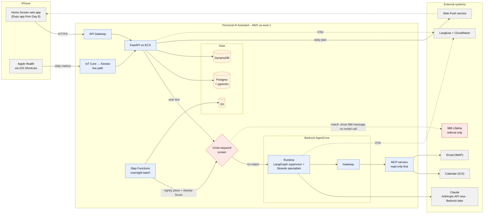

# Personal AI Assistant

A personal project for working through the system design, architecture and deployment decisions
behind an enterprise AI platform. The platform is an agentic assistant: agents read calendar,
email and health data through MCP, plan the day, and reach the user on their phone. It is
designed for production on AWS at 1M+ users, with privacy, guardrails and human approval built
in from the start.

The test environment is my own phone. It exercises both data paths: overnight batch jobs that turn uploaded data into plans sent back to the phone, and a live
path that streams signals from the phone into the platform, with notifications going back out.
Real-time streaming back to the device is the next part to be designed.

The implementation lives in a private repository. This repository holds the system design, the
architecture decision records and the deployment lessons from each two-week sprint.

**Start here: [Design v0](architecture/design-v0.md)** covers system context and containers
(C4 levels 1 and 2), the POC and target v1 architecture, data sources and retention, the safety
model and the open questions.

## System overview

Target v1 architecture on AWS:

## Key design choices

- **Safety before the model.** All user text passes a crisis screen before any model call. On a
  match, the user gets the 988 Suicide & Crisis Lifeline message and the model is never called.
  Tests enforce this on every route that reaches a model.
- **Read-only tools, human approval for writes.** Agents reach data only through MCP servers
  behind one gateway, so they never hold credentials. Any future write action, such as sending
  a message or creating an event, needs explicit approval each time.
- **Supervisor and specialists.** A LangGraph supervisor sends work to small Strands specialist
  agents on Bedrock AgentCore.
- **Batch and live paths kept apart.** Nightly planning runs in Step Functions. Real-time
  signals arrive through IoT Core and Kinesis.
- **Start cheap, design for scale.** The POC runs on a laptop with SQLite and no cloud spend.
  v1 moves to AWS with Postgres + pgvector, DynamoDB and S3, each with a defined role.
- **Infrastructure as code only.** Every AWS resource is created through Terraform, and local
  tooling uses read-only credentials.
- **Testable and private by default.** Model clients are injected, so tests never call paid
  APIs. Tests and evals use synthetic personas only, never real personal data.
- **A real device as the test environment.** A real phone drives the batch and live paths end
  to end, so latency, delivery and offline behaviour are tested on real hardware, not only
  simulated.
- **Observable from day one.** Services and agents emit OpenTelemetry traces to Langfuse, with
  PII redacted.

## Contents

| Path | What it holds |
|---|---|
| [architecture/design-v0.md](architecture/design-v0.md) | Design v0: C4 context and containers, data, safety, open questions |
| [architecture/overview.mmd](architecture/overview.mmd) | Mermaid source for the system overview above |

Architecture decision records and sprint retrospectives are added as each sprint closes.

## Status

Sprint 1 (October 2026): single-user POC, moving toward the v1 architecture on AWS.

Christian Dudziak
