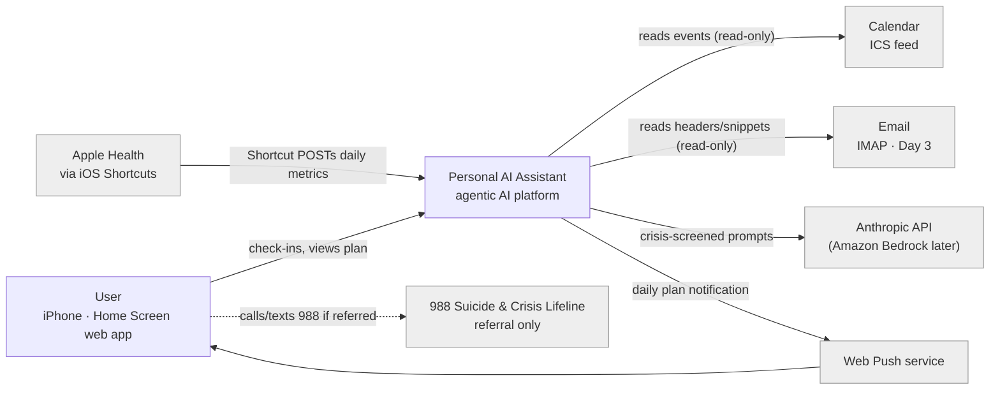
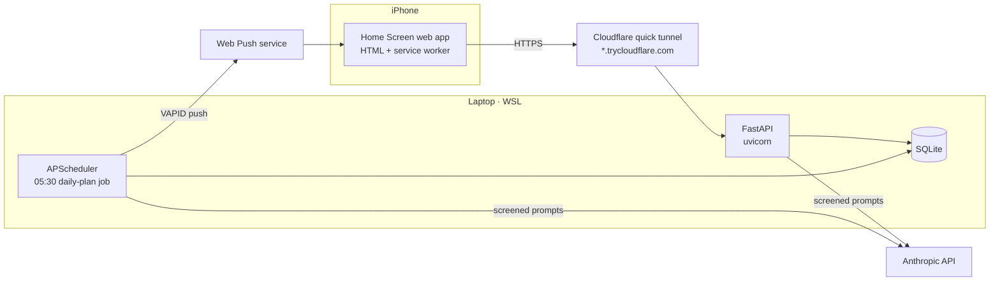
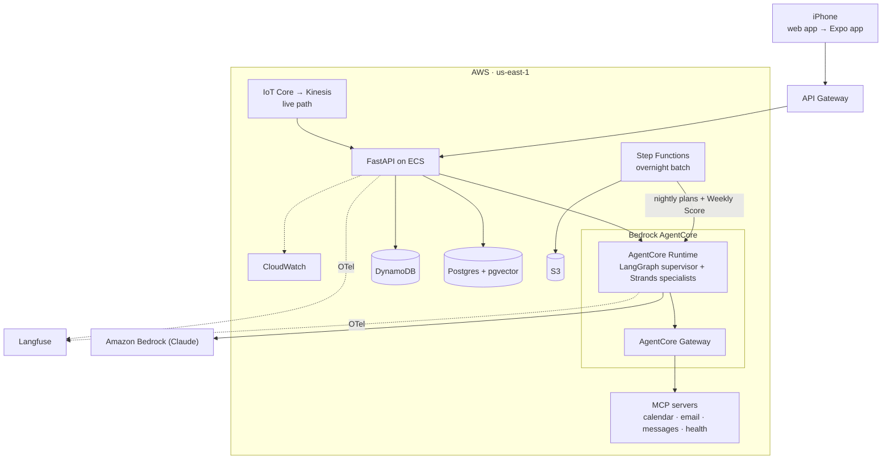
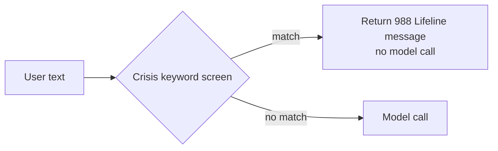

# Personal AI Assistant: Design v0

**Status:** Draft · **Date:** 2026-10-26 · **Author:** Christian Dudziak

## 1. Purpose

Personal AI Assistant is an agentic AI platform. Its agents read the user's calendar, email,
messages and health data through MCP, write a daily plan across a set of life domains, and score
the week with a Weekly Score. It is designed as a production platform on AWS for 1M+ users, with
privacy, guardrails and human approval as first-class features. The founder is user #1.

## 2. System context (C4 Level 1)

Personal AI Assistant never sends data to 988. It only shows the referral message.

## 3. Containers (C4 Level 2)

### 3a. POC (now)

The POC has a single user and a single process. The scheduler runs inside the FastAPI process,
so the laptop must be awake at 05:30.

### 3b. Target v1 (end of Sprint 1)

Proposed store roles: **Postgres** holds the profile, plans, scores and embeddings.
**DynamoDB** holds sessions, push subscriptions and rate limits. **S3** holds raw imports and
batch artifacts. All of it is provisioned with Terraform.

## 4. Life domains

| Domain | What the assistant covers | Main data sources |
|---|---|---|
| Body | Sleep, training, nutrition, recovery, health metrics | Apple Health (sleep, HRV, workouts, steps), check-ins |
| Mind | Focus, stress, mood, learning, mental-health check-ins | Mood check-ins, calendar load, Apple Health (HRV, mindful minutes) |
| Relationships | Friends and family; staying in touch | Calendar, email, messages (v1) |
| Family | Time and presence at home | Calendar, check-ins |
| Career | Priorities, deep work, meetings, growth, income | Calendar, email |
| Legacy | Long-term goals, values, giving back | Profile goals, weekly reflections |

## 5. Data sources

| Source | How it arrives | Sensitivity | Stored in | Retention (proposed) |
|---|---|---|---|---|
| Calendar | Private ICS URL polled read-only | Medium | SQLite `events` | 30 days rolling |
| Email (Day 3) | IMAP read-only; headers + snippets only | High | Derived summaries only, never raw bodies | Summaries 30 days |
| Apple Health | iOS Shortcut POSTs JSON daily | High | SQLite `health_daily` | 1 year |
| Check-ins / chat | Typed in the web app | High | SQLite `checkins` | 1 year; delete on request |
| Messages | MCP server (v1, not in POC) | High | Not stored in POC | TBD |
| Profile & goals | Local `profile.json` (gitignored) | High | Local file | Until the user deletes it |
| Plans & Weekly Score | Model output | Medium | SQLite `plans`, `scores` | 1 year |
| Push subscription | Browser PushManager | Low | SQLite | Until unsubscribed |
| Traces (v1) | OpenTelemetry → Langfuse | High | Langfuse, PII redacted | 30 days |

Credentials such as the IMAP app password, the Anthropic key and the VAPID keys live in `.env`
for the POC and in AWS Secrets Manager in v1. They are never stored in the database or in git.

## 6. Safety and privacy

- **Crisis screen first:** all user text is screened for crisis keywords before any model call.
  On a match, the API returns the 988 Suicide & Crisis Lifeline message and does not call the
  model. Every route that reaches a model goes through this screen, and tests enforce it.
- **No secrets or personal data in git:** `.env*`, `profile.json`, `*.db`, recorded sessions and
  real health data are gitignored and never committed. Only `.env.example` with placeholder
  values is committed.
- **Synthetic data only:** tests and evals use synthetic personas. Model clients are injected,
  so tests never hit paid APIs.
- **Read-only tools first:** calendar, email, health and messages start as read-only. Any future
  write action, such as sending a message or creating an event, needs explicit human approval
  each time.
- **Least privilege in AWS:** Terraform is the only way to create AWS resources. The local CLI
  uses a read-only profile.

## 7. Open questions

- **Crisis screen depth:** is a keyword list enough, or do we add a classifier? How do we
  handle false positives, and what (if anything) is logged on a match?
- **POC reachability:** the quick-tunnel URL changes on every restart, which breaks the Home
  Screen app and the push subscription. Do we switch to a named tunnel, or deploy earlier?
- **Retention and deletion:** confirm the retention values above and define a "delete my data"
  flow before v1.
- **Runtime boundary:** which logic lives in FastAPI on ECS and which in AgentCore Runtime?
  When does the move from the Anthropic API to Bedrock happen?
- **Weekly Score:** what are the domain weights, how is missing data handled, and how is the
  score explained to the user?
